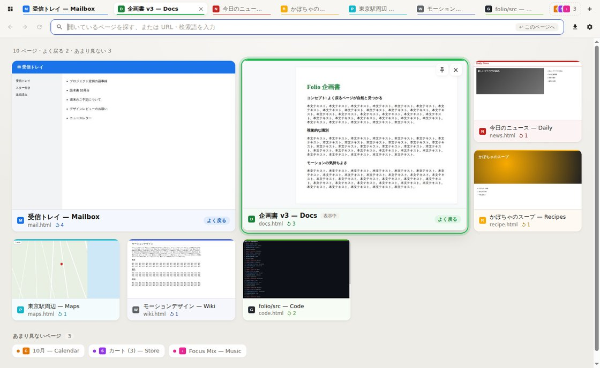
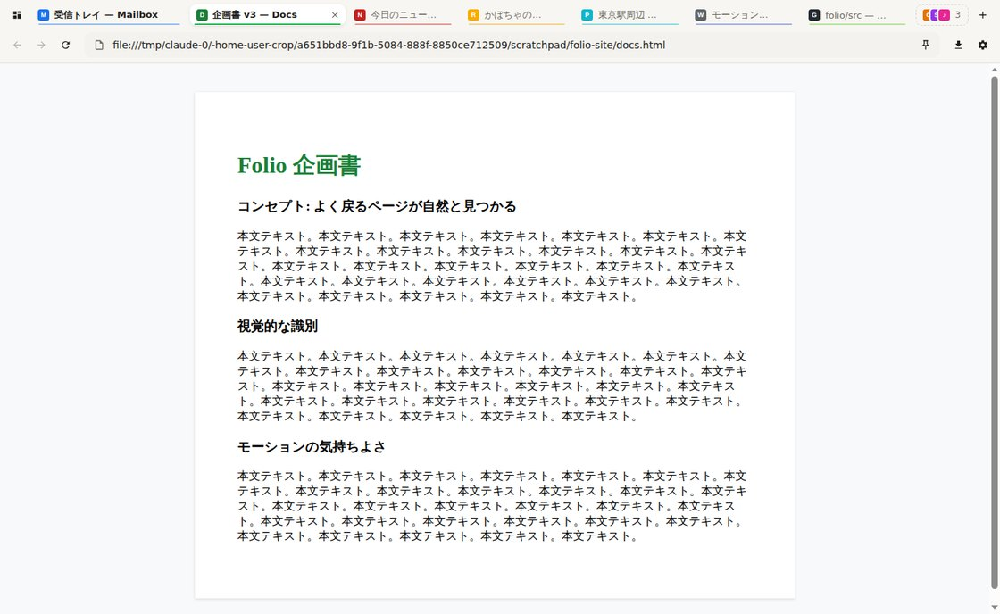
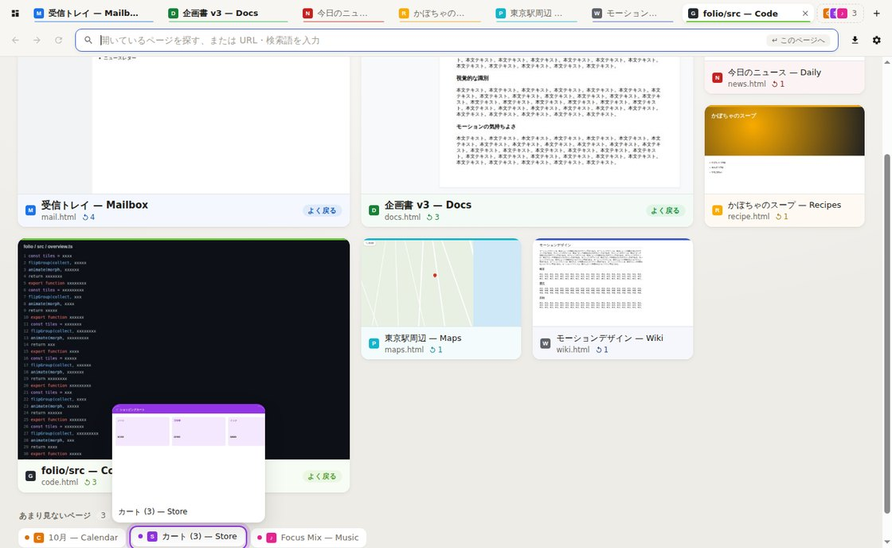

# Folio

**よく戻るページが、自然と見つかる。**

Folio は、タブが増えてもページを「見た目」と「動き」で見分けられるデスクトップ Web ブラウザです。
タイトルの文字列を読み比べなくても、ページのプレビュー・色・大きさ・置き場所から、目当てのページに戻れることを目指しています。



## 体験

### よく戻るページほど大きく、あまり見ないページは小さくまとめる

- 別のタブから**戻ってきた回数**をいちばん重視してスコアを付けます (開いただけ: +1、戻ってきた: +2.5)。
  古い行動の影響は 3 日ごとに半分になり、スコアは再起動後も引き継がれます。
- スコアに応じて、ページを 3 段階で表示します。
  | 段階 | オーバービュー | タブストリップ |
  | --- | --- | --- |
  | よく戻る | 2×2 の大きなプレビュー + 「よく戻る」タグ | 幅の広いタブ・太字 |
  | 通常 | 標準のプレビュー | 標準のタブ |
  | あまり見ない | 下部の小さなチップ (マウスを乗せるとプレビュー) | ファビコンを重ねた 1 つの「束」 |
- 開いて 3 分たっても戻ってこなかったページが「あまり見ない」にまとまります (表示中・開いたばかり・固定したページはまとめません)。
- 段階の境目にはゆとり (ヒステリシス) があり、ページが大きくなったり小さくなったりを繰り返しません。
- 📌 で固定したページは、常に大きく表示されます。

### ページを見分ける手がかり

- **プレビュー**: ページを表示したときと、別のページへ移るときに自動で撮影します。タイルはウィンドウと同じ縦横比なので、見ていた画面がそのまま縮んだ形で並びます。
- **ページの色**: `theme-color` か、スクリーンショットから代表色を求めます。タブの下線・タイルの帯・チップの点・選択リングに同じ色を使うので、どこに表示されても同じページだとわかります。
- **戻ってきた回数** (↺ 3) をタイルに表示し、なぜ大きいのかがわかるようにしています。

### 動き

すべての動きはバネの物理シミュレーションから作ったイージング (CSS `linear()`) で、`transform` と `opacity` だけを動かします。派手に跳ねず、少しだけ「着地」する感触にそろえています。

| 操作 | 動き |
| --- | --- |
| オーバービューを開く (Ctrl+E) | 表示中のページが、そのままの絵で自分のタイルへ縮んで着地。ほかのタイルは元の位置から波紋のように順に現れる |
| ページを選ぶ (クリック / Enter) | タイルがページの大きさまで広がり、そのまま本物のページに切り替わる |
| 選択 (矢印キー / マウス) | 選択リングがページの色をまといながら滑って移動 |
| 絞り込み (文字を入力) | 外れたページは縮みながら消え、残ったページが詰めて並び直す |
| タブを切り替える | 現在のタブの下地が滑って移動 |
| 段階が変わる・閉じる・増える | 元の位置・大きさから新しい位置へ移動 (束から出てきたタブは束から広がる) |

OS の「視差効果を減らす」設定がオンのときは、動きを短いフェードに置き換えます。

### オーバービュー = ランチャー

Ctrl+T で開く「新しいページ」もオーバービューです。入力すると、まず**開いているページ**と**閉じたけれどよく戻っていたページ**、**履歴**から探し、見つからなければ Enter で開く / 検索します。同じページを何枚も開いてしまうのを防ぎます (Shift+Enter で常に新しく開く)。

| | |
| --- | --- |
|  |  |

## 起動方法

Node.js 20 以上が必要です。

```bash
npm install     # 依存関係 (Electron など) のインストール
npm start       # ビルドして起動
npm test        # ユニットテスト (スコア・段階分け・色・URL 解釈)
npm run dist    # インストーラーを作成 (release/ に出力)
```

`FOLIO_FAST_TIERS=1 npm start` で起動すると、「あまり見ない」にまとまるまでの時間が 3 秒になり、段階の変化をすぐ試せます。

GitHub Actions でも Windows (.exe) / macOS (.dmg) / Linux (.AppImage) のインストーラーがビルドされます。

## 操作

| 操作 | キー |
| --- | --- |
| オーバービュー | Ctrl+E (もう一度 / Esc で戻る) |
| 新しいページ (ランチャー) | Ctrl+T |
| オーバービューで移動 / 開く | 矢印キー・Tab / Enter |
| 入力どおりに新しく開く | Shift+Enter |
| 選んだページを閉じる | Delete (入力欄が空のとき)・中クリック |
| このタブを固定 | Ctrl+D |
| タブを閉じる / 閉じたタブを開く | Ctrl+W / Ctrl+Shift+T |
| 次 / 前のタブ | Ctrl+Tab / Ctrl+Shift+Tab |
| アドレス欄 / ページ内検索 | Ctrl+L / Ctrl+F |
| 戻る / 進む / 再読み込み | Alt+← / Alt+→ / Ctrl+R |
| ダウンロード / 設定 | Ctrl+J / Ctrl+, |

macOS では Ctrl の代わりに Cmd を使います。

## 技術構成

- **Electron (Chromium)**: ブラウザエンジンを自作せず、実際の Web をそのまま表示できる。各タブは `WebContentsView` で、`sandbox` と `contextIsolation` を有効にしている。
- **TypeScript**: メインプロセス・UI・共有型を 1 つの言語で書き、IPC の型をそろえる。
- **UI は素の DOM + Web Animations API**: フレームワークを使わず、FLIP とバネのイージングを直接制御する。
- **ページ ⇄ タイルの変形**: Web ページ (ネイティブのビュー) は HTML の上に描かれるため、そのままでは動かせない。
  オーバービューに入るときは、ページを撮影 → UI が同じ位置に同じ絵を置く → 本物のページを外す → 絵をタイルへ動かす、という順で継ぎ目なく切り替える。
- 画面に表示されていないビューは撮影できない (Electron の制約) ため、プレビューはページを表示している間と、別のページへ移る瞬間に撮る。一度も表示していないタブは、ページの色とファビコンで描いた代わりの絵を出す。

```
src/
  main/
    main.ts         起動・IPC・権限リクエスト
    window.ts       ウィンドウとタブ、オーバービューへの切り替え、プレビュー撮影
    frecency.ts     再閲覧スコアと段階分け (純粋関数)
    color.ts        ページの色を求める (純粋関数)
    thumbnails.ts   撮影とディスクへの保存
    store.ts        スコア・履歴・設定・セッションの保存
    menu.ts / contextMenu.ts / downloads.ts / url.ts / errorPage.ts
  preload/          UI に公開する API
  renderer/
    motion.ts       バネ → linear() イージング、FLIP、残像
    overview.ts     オーバービュー (タイル・チップ・選択・変形)
    strip.ts        タブストリップ
    renderer.ts     ツールバー・アドレス欄・パネル
  shared/types.ts   メインと UI の共有型
```

データはユーザーデータフォルダ (例: Windows なら `%APPDATA%/Folio`) に保存されます。
