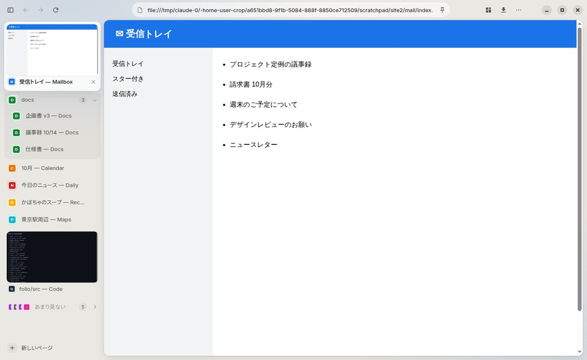
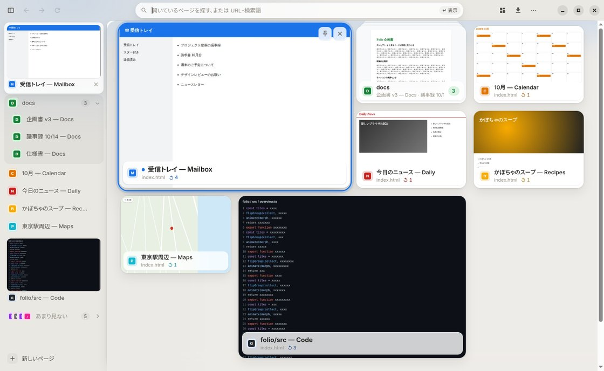
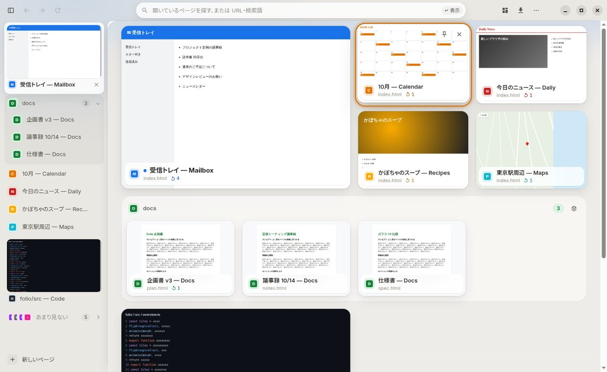
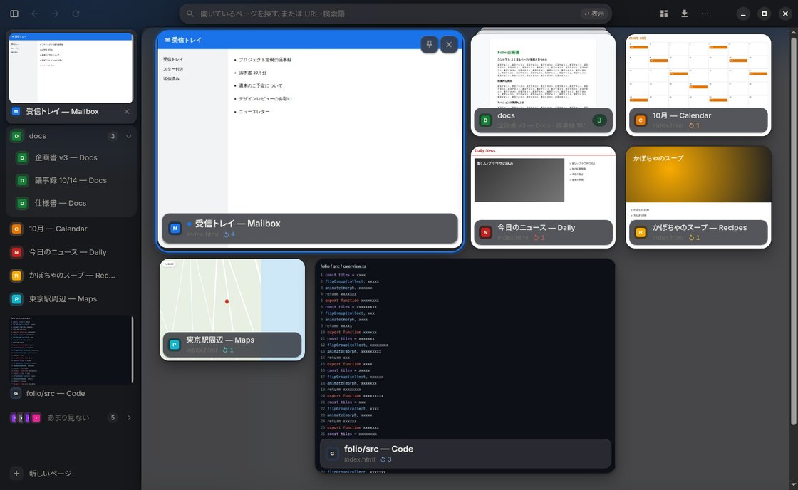
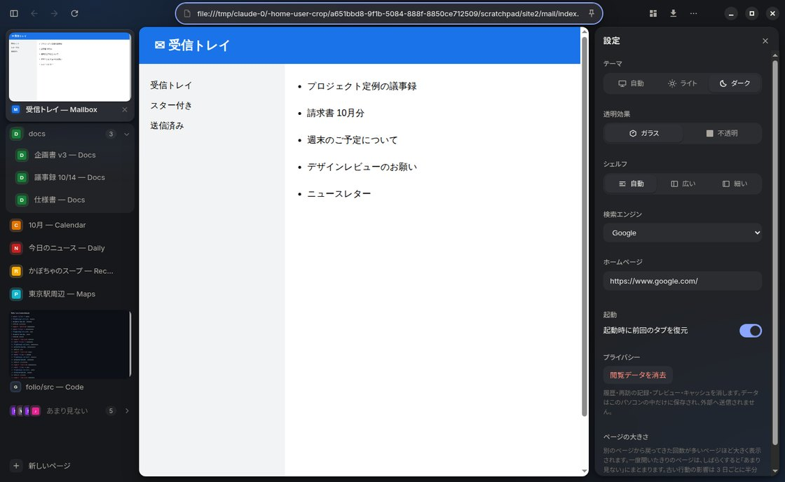
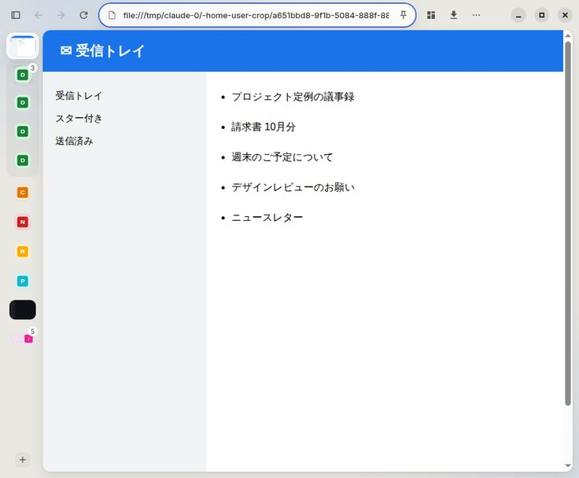
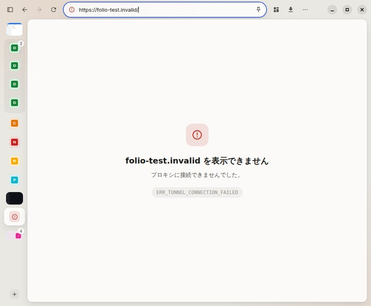

# Folio

**よく戻るページが、自然と見つかる。**

Folio は、タブが増えてもページを「見た目」と「動き」で見分けられる Windows 向けのデスクトップ Web ブラウザです。
タイトルを読み比べなくても、プレビュー・ページの色・大きさ・置き場所から目当てのページへ戻れることを目指しています。



## インストール

GitHub Actions がビルドした実行ファイルを使います (Actions → 最新の「Build Folio」→ Artifacts の **Folio-Windows**)。

| ファイル | 内容 |
| --- | --- |
| `Folio-Setup-x.y.z.exe` | インストーラー。スタートメニュー・デスクトップに登録され、「アプリ」から削除できる |
| `Folio-x.y.z-portable.exe` | インストール不要。ダブルクリックで起動 |

コード署名をしていないため、初回は SmartScreen の警告が出ます (「詳細情報」→「実行」)。
対応 OS は Windows 10 / 11 (x64)。Windows 11 22H2 以降では、OS のすりガラス (Acrylic) が背景に使われます。

## 画面

```
┌──────────────────────────────────────────────── ─ □ × ┐
│ ◧ ← → ⟳      (  🔒 example.com/…              📌 )   ▦ ⤓ ⋯ │  上部バー (ガラス・ウィンドウを掴める)
├────────────┬──────────────────────────────────────────┤
│ ▣ よく戻る  │ ╭──────────────────────────────────────╮ │
│   (プレビュー) │ │                                      │ │
│ ◉ docs  3 ˅ │ │        Web ページ (角丸のカード)          │ │
│   ・企画書   │ │                                      │ │
│ ◉ ニュース   │ ╰──────────────────────────────────────╯ │
│ ◎◎◎ あまり見ない│                                          │
└────────────┴──────────────────────────────────────────┘
   シェルフ                   ステージ
```

- **上部バー**: 戻る・進む・再読み込み、アドレス欄、スペース・ダウンロード・メニュー。読み込み中はアドレス欄の下端を細い線が流れ、暗号化されていない接続には「保護なし」と出ます。
- **シェルフ (左)**: 開いているページの一覧。よく戻るページはプレビュー付きのカード、通常のページは 1 行、同じサイトは開閉できるまとまり、あまり見ないページは 1 つの束。表示中のページの下地 (ガラス) がバネで滑ります。ウィンドウが狭いとアイコンだけの細いシェルフになります。
- **ステージ**: Web ページは角丸のカードとして、ガラスの上に浮かんで表示されます。
- **スペース (Ctrl+E)**: 開いているページを一望する画面。表示中のページがそのまま自分のカードへ縮み、ほかのカードが周りに順に現れます。

| スペース | まとまりを広げたところ |
| --- | --- |
|  |  |

| ダーク | 設定 |
| --- | --- |
|  |  |

| 狭いウィンドウ | 読み込みエラー |
| --- | --- |
|  |  |

## 見分け方の仕組み

- **大きさ = 戻ってきた回数**: 別のタブから戻ってきた行動を最も重く数えます (開いただけ +1、戻ってきた +2.5、3 日で半分に減衰)。よく戻るページは 2×2 の大きなカード、開いたきりのページは「あまり見ない」の束へ。境目にはゆとりがあり、大きさが頻繁に入れ替わりません。
- **場所 = タブの順番**: 頻度で並べ替えないので、カードが飛び回らず位置を覚えられます。よく戻るページは「その場で」大きくなります。📌 で固定したページは先頭で常に大きく表示されます。
- **まとまり = 同じサイト**: 同じサイト (ファイルなら同じフォルダ) のページは、紙を重ねた束にまとまります。クリックすると横長のトレイに広がり、閉じると束へ吸い込まれます。
- **色 = ページの色**: `theme-color` かスクリーンショットから代表色を取り、ファビコンの下地・カード・選択リング・背景の色味に使います。
- **プレビューが無いとき**: 一度も表示していないタブは撮影できない (Electron の制約) ため、ページの色と大きなファビコンで描いた絵を出します。プレビューのために追加の権限やページ情報の取得はしていません。

## モーション

すべてバネの物理シミュレーションから作ったイージング (CSS `linear()`) で、`transform` と `opacity` だけを動かします。跳ねすぎず、わずかに「着地」する感触にそろえています。

| 動き | 使っている場面 |
| --- | --- |
| Shared-element transition | ページ ⇄ スペースのカード (同じ絵が連続して変形) |
| Staggered entrance | スペースを開いたとき、元のページの位置から波紋のように |
| Scale and lift | ホバー・選択中のカードがわずかに手前へ浮く |
| Reflow | 閉じた・絞り込んだ後に、残ったカードが詰め直す |
| Morphing group | まとまりの束 ⇄ トレイ |
| Progressive emphasis | 再訪に応じて行 → カード、標準 → 2×2 へ |
| Spring glide | シェルフの下地、スペースの選択リング |
| Crossfade | プレビューの差し替え、背景の色味の移り変わり |

Windows の「アニメーション効果」をオフにすると、動きは短いフェードに置き換わります。

## デザインシステム

`src/renderer/styles.css` の先頭にトークンとして定義しています。

- **レイヤー**: 0 = ウィンドウの背景 (OS のすりガラス)、1 = ガラスのパネル・カード、2 = 不透明なカード (Web ページ・プレビュー)。階層は線ではなく重なりと影で表します。
- **ガラス**: `--glass` (半透明) / `--glass-strong` (文字を載せる面) / `--glass-edge` (縁の明るい線) と `--blur-panel` / `--blur-card`。小さいカードの文字の下は不透明度を上げています。
- **透明効果**: 自動 (Windows 11 は OS の Acrylic、それ以外はアプリ内のガラス) / 不透明。Windows の「透明効果」オフやハイコントラストでは自動的に不透明になります。
- **テーマ**: 自動 (OS に合わせる) / ライト / ダーク。
- **文字**: 欧文 Inter + 和文 Noto Sans JP (可変ウェイト、アプリに同梱)。`palt` で約物を詰め、欧文と和文の字面をそろえています。
- **余白・角丸・影・文字サイズ**: `--sp-*` / `--r-*` / `--shadow-1..3` / `--fs-*`。

## 操作

| 操作 | キー |
| --- | --- |
| スペース (もう一度 / Esc で戻る) | Ctrl+E |
| 新しいページ (ランチャー) | Ctrl+T |
| スペースで移動 / 開く / 広げる | 矢印キー・Tab / Enter |
| 入力どおりに新しく開く | Shift+Enter |
| シェルフの幅 | Ctrl+Shift+S |
| シェルフで移動 / まとまりの開閉 | ↑↓ / →← |
| このタブを固定 | Ctrl+D |
| タブを閉じる / 閉じたタブを開く | Ctrl+W / Ctrl+Shift+T |
| アドレス欄 / ページ内検索 | Ctrl+L / Ctrl+F |
| ダウンロード / 設定 | Ctrl+J / Ctrl+, |

## セキュリティとプライバシー

見た目より安全性を優先し、[Electron のセキュリティチェックリスト](https://www.electronjs.org/docs/latest/tutorial/security) に沿っています。

- Web ページはアプリ本体と別のプロセス・別のセッションで、`sandbox`・`contextIsolation` 有効、Node.js なし。`<webview>` は使用禁止。
- アプリの UI は `file://` ではなく専用の `folio://` から配信し、UI 専用のセッションに閉じ込めています。UI からの外部通信はすべて遮断 (ファビコンもメインプロセスが取得して渡す)。CSP で外部スクリプトも禁止。
- UI からの IPC は、送り主が Folio の UI のメインフレームかを毎回確認します。
- Electron Fuses で RunAsNode・NODE_OPTIONS・inspect 引数を無効化し、app.asar 以外からの読み込みを禁止、asar の整合性を検証します。
- カメラ・マイク・位置情報・通知などはサイトごとに確認します。
- 閲覧データ (履歴・再訪の記録・プレビュー) は `%APPDATA%\Folio` にのみ保存し、外部へ送信しません。設定から消去できます。

## 開発

```bash
npm install
npm start                      # ビルドして起動
npm test                       # 型チェック後のユニットテスト (スコア・段階・並べ方・色・URL)
npm run dist -- --win --x64    # Windows の実行ファイル (Windows 上で実行)
FOLIO_FAST_TIERS=1 npm start   # 「あまり見ない」になるまでの猶予を 3 秒にして試す
```

```
src/
  main/        メインプロセス
    main.ts          起動・IPC (送り主の確認)・権限・見た目 (テーマ/ガラス)
    appProtocol.ts   folio:// と UI 専用セッション
    window.ts        ウィンドウ・タブ・スペースへの切り替え・プレビュー撮影
    frecency.ts      再訪スコアと段階分け
    color.ts         ページの色
    favicons.ts      ファビコンの取得 (data: URL 化)
    thumbnails.ts / store.ts / menu.ts / contextMenu.ts / downloads.ts / url.ts / errorPage.ts
  preload/     UI に公開する最小限の API
  renderer/    UI (フレームワークなし)
    styles.css       デザイントークンと全コンポーネント
    motion.ts        バネ → linear() イージング、FLIP、残像
    model.ts         シェルフとスペース共通の並べ方・まとめ方
    shelf.ts         シェルフ
    overview.ts      スペース
    renderer.ts      上部バー・アドレス欄・ページ内検索・シート
build/icon.png   アプリアイコン
```
