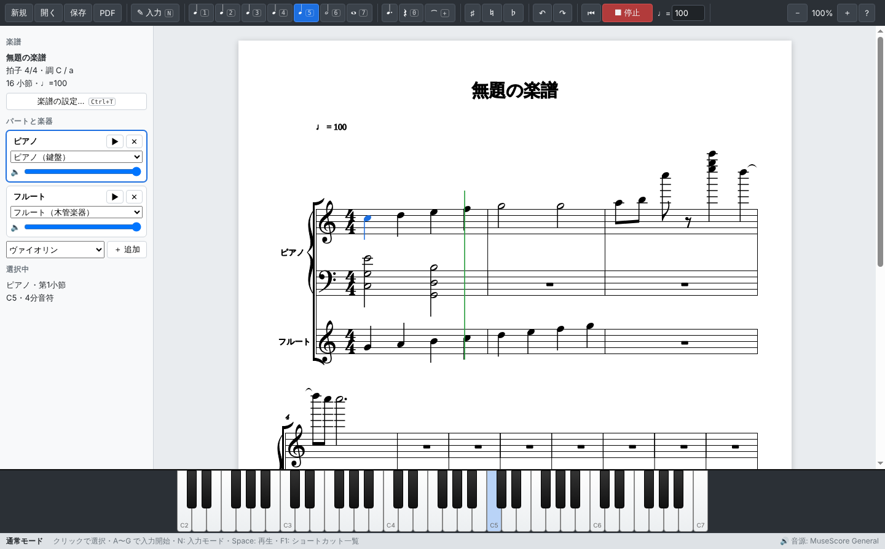

# FolioScore

鍵盤中心で楽譜を作成・編集・再生できる、Windows 向けのデスクトップ楽譜制作ソフトです。
MuseScore と同じ感覚のキーボード操作で音符を入力でき、同梱の高品質 SoundFont で複数の楽器をパートごとに鳴らせます。



## 主な機能

| 分類 | 内容 |
|---|---|
| 音符入力 | `N` で入力モード。`A`〜`G` で音名、`1`〜`7` で音価（MuseScore 互換）、`.` 付点、`0` 休符、`+` タイ、`Shift+音名` で和音、`↑↓` 半音、`Ctrl+↑↓` オクターブ |
| 鍵盤入力 | 画面下のピアノ鍵盤をクリックしてそのまま入力（`Shift+クリック` で和音）。USB-MIDI 鍵盤も自動認識（押したまま次の鍵を押すと和音） |
| 少ない操作 | 入力モードでなくても `A`〜`G` や鍵盤を押せば選択位置から入力開始。入力中も `Space` で即再生、`Ctrl+S` で即保存 |
| 楽譜表示 | VexFlow による浄書。ページ表示（A4 比）、自動段組み・ページ分け、大譜表、調号・臨時記号の自動付与、連桁・タイ（段またぎ対応）、音域に応じた段間隔の自動調整 |
| 編集 | クリック選択、`Shift+←→` 範囲選択、移調、コピー／切り取り／貼り付け、休符化、音価変更、小節の追加・挿入・削除、拍子変更時の自動再小節割り、元に戻す／やり直し（300 段階） |
| 楽器・パート | 21 種類の厳選楽器（ピアノ、弦楽器、木管、金管、合唱、打楽器）。パートごとに楽器・音量を設定、▶ ボタンで試聴 |
| 再生 | 選択位置から再生、再生位置カーソル表示と自動スクロール、テンポ変更 |
| ファイル | `.folio`（JSON）で保存・読込、PDF / MusicXML / MIDI / WAV 書き出し |
| テンプレート | ピアノ、独奏＋ピアノ、弦楽四重奏、木管三重奏、合唱＋ピアノ |

## インストール（Windows）

ビルド済みの実行ファイルは次の 2 種類です。

- `FolioScore-Setup-<version>.exe` … インストーラ版（インストール先の選択、デスクトップショートカット、`.folio` の関連付け）
- `FolioScore-<version>-portable.exe` … インストール不要のポータブル版（ダブルクリックで起動）

GitHub Actions（`.github/workflows/folioscore-windows.yml`）が Windows ランナー上でビルドし、
**Actions の実行結果ページ → Artifacts → `FolioScore-Windows`** から両方をダウンロードできます。

> コード署名をしていないため、初回起動時に Windows SmartScreen の警告が出ることがあります。「詳細情報」→「実行」で起動できます。

## キーボードショートカット

アプリ内では `F1` で一覧を表示できます。

| キー | 動作 |
|---|---|
| `N` | 音符入力モードの切替 |
| `A`〜`G` | 音名を入力（直前の音に最も近いオクターブ、調号を自動反映） |
| `Shift` + `A`〜`G` | 直前の音の上に和音を追加 |
| `1`〜`7` | 音価: 1=64分 2=32分 3=16分 4=8分 5=4分 6=2分 7=全音符（通常モードでは選択音符の音価を変更） |
| `.` / `0` / `+` | 付点 / 休符 / タイ |
| `↑` `↓` / `Ctrl+↑` `Ctrl+↓` | 半音 / オクターブ移動 |
| `←` `→` / `Shift+←→` / `Ctrl+←→` | 移動 / 範囲選択 / 小節移動 |
| `Alt+↑` `Alt+↓` | 上下の譜表へ移動 |
| `Delete` / `Backspace` | 休符にする / 直前の入力を取り消し |
| `Ctrl+C` `Ctrl+X` `Ctrl+V` | コピー / 切り取り / 貼り付け |
| `Ctrl+Z` / `Ctrl+Y` | 元に戻す / やり直し |
| `Space` / `Home` | 再生・停止 / 先頭へ |
| `Ctrl+S` / `Ctrl+Shift+S` / `Ctrl+O` / `Ctrl+N` | 保存 / 名前を付けて保存 / 開く / 新規作成 |
| `Ctrl+P` | PDF に書き出し |
| `Ctrl+B` / `Ctrl+Insert` / `Ctrl+Delete` | 小節を末尾に追加 / 挿入 / 削除 |
| `Ctrl+T` | 楽譜の設定（タイトル・作曲者・拍子・調・テンポ） |
| `Ctrl+=` `Ctrl+-` `Ctrl+0` | 拡大 / 縮小 / 100% |
| `F9` | ピアノ鍵盤の表示切替 |

入力モードでは、楽譜上をクリックするとその高さの音をその位置に入力できます。

## 同梱音源とライセンス

楽器の数より音質を優先し、**再配布が明示的に許可されたライセンス**の音源のみを採用しています。

### 採用音源: MuseScore General SoundFont v0.2（SF3 形式, 約 38 MB）

| 項目 | 内容 |
|---|---|
| 作成者 | S. Christian Collins（MuseScore 向けに FluidR3Mono を改良） |
| 元となった音源 | FluidR3 (© 2000-2002, 2008 Frank Wen) / FluidR3Mono (© 2014-17 Michael Cowgill) |
| その他のクレジット | Temple Blocks © 2002 Ethan Winer / Drumline Cymbals © 2016 Michael Schorsch |
| ライセンス | **MIT License**（商用・再配布・改変可。著作権表示の同梱が条件） |
| 入手元 | https://ftp.osuosl.org/pub/musescore/soundfont/MuseScore_General/ |
| 同梱場所 | `resources/soundfonts/MuseScore_General.sf3`（ライセンス全文: `resources/soundfonts/MuseScore_General_License.md`） |

採用理由:
- MuseScore 4 以前の標準音源として長年使われ、楽器ごとの音量バランス・音域が楽譜再生向けに調整済み。
- ピアノは Steinway Model D を収録した「Splendid Grand」（パブリックドメインのサンプル）を基にした高品質なもの。
- SF3（Ogg Vorbis 圧縮）なので、同等内容の SF2（約 200 MB）より大幅に小さく配布できる。
- MIT ライセンスのため、アプリへの同梱・再配布に制約がない。

アプリ内では、この音源の中から楽譜制作でよく使い、音質の良いプリセットを 21 種類に厳選して公開しています
（ピアノ、チェンバロ、パイプオルガン、チェレスタ、ヴァイオリン、ヴィオラ、チェロ、コントラバス、弦楽合奏、ハープ、クラシックギター、
フルート、オーボエ、クラリネット、ファゴット、トランペット、ホルン、トロンボーン、合唱、マリンバ、ヴィブラフォン）。

> リポジトリには SoundFont 本体（約 38 MB）をコミットせず、`npm run build` 時に `scripts/fetch-soundfont.mjs` が公式ミラーから取得し SHA-256 を検証します。
> ビルドされた `.exe` には音源が同梱されるため、利用者側でのダウンロードは不要です。

### 使用ライブラリ

| ライブラリ | 用途 | ライセンス |
|---|---|---|
| [Electron](https://www.electronjs.org/) | デスクトップアプリ実行環境 | MIT |
| [VexFlow 5](https://github.com/vexflow/vexflow) | 楽譜の浄書・描画 | MIT |
| Bravura / Academico フォント（VexFlow 同梱） | 音楽記号フォント | SIL Open Font License 1.1 |
| [spessasynth_lib / spessasynth_core](https://github.com/spessasus/spessasynth_lib) | SoundFont シンセサイザー（AudioWorklet） | Apache-2.0 |

各ライセンスの全文は [`THIRD_PARTY_LICENSES.md`](THIRD_PARTY_LICENSES.md) にまとめ、`.exe` にも同梱しています（インストール先の `resources/` 内）。
アプリの「ヘルプ → FolioScore について / ライセンス」でもクレジットを表示します。

## 開発

### 必要環境

- Node.js 22 以上（npm 10 以上）
- Windows 10/11、macOS、Linux（開発・テストはどの OS でも可能）

### コマンド

```bash
cd folioscore
npm ci                 # 依存関係のインストール
npm start              # ビルドしてアプリを起動
npm run typecheck      # TypeScript 型チェック
npm test               # データモデル・書き出しのユニットテスト
npm run e2e            # Electron を起動し、キー入力→表示→保存→読込→書き出し→再生を自動検証
npm run dist:win       # Windows 用インストーラ + ポータブル exe を release/ に生成
```

### 構成

```
folioscore/
├─ src/main/main.ts         メインプロセス（ウィンドウ、メニュー、ファイル入出力、PDF 書き出し）
├─ src/main/preload.ts      レンダラーへ公開する安全な API（contextIsolation 有効）
├─ src/renderer/model.ts    楽譜データモデルと編集アルゴリズム（上書き入力、タイ分割、休符正規化、拍子変更）
├─ src/renderer/render.ts   VexFlow によるページレイアウト・描画・当たり判定
├─ src/renderer/audio.ts    SpessaSynth による再生・試聴・WAV 書き出し
├─ src/renderer/app.ts      エディタ UI（キー操作、選択、鍵盤、パネル、ダイアログ）
├─ src/renderer/midi.ts     MIDI (SMF) 書き出し
├─ src/renderer/musicxml.ts MusicXML 4.0 書き出し
├─ src/renderer/instruments.ts 公開する楽器の一覧
├─ resources/soundfonts/    同梱音源とライセンス
├─ scripts/                 ビルド、音源取得、E2E 実行
└─ test/                    ユニットテスト / E2E シナリオ
```

`.folio` ファイルは UTF-8 の JSON で、パート → 譜表 → 小節 → イベント（音価・付点・音高・タイ）の構造です。

## Windows 用 .exe のビルドについて

### この開発環境（Linux コンテナ）での結果

この環境は Linux のため Windows をネイティブには実行できませんが、electron-builder のクロスビルドで次を生成できました。

| 成果物 | 生成 | 補足 |
|---|---|---|
| `release/win-unpacked/FolioScore.exe`（x64） | ✅ | 音源・ライセンスが `resources/` に同梱されていることを確認 |
| `FolioScore-<version>-portable.exe` | ✅ | wine 不要で生成可能 |
| `FolioScore-Setup-<version>.exe`（NSIS インストーラ） | ✅ | アンインストーラ生成のため **wine（32bit 含む）** が必要 |

ただし、生成した Windows 版 exe を **この環境で実際に起動して確認することはできませんでした**。
wine 上では Electron（Chromium）のレンダラーが起動せず、インストーラのサイレントインストールも wine では完了しませんでした。
アプリの動作確認は、同じソースを Linux 版 Electron で実行する E2E テスト（下記）で行っています。
実 Windows での確認は、GitHub Actions の Windows ランナーで E2E テストとビルドを実行して行います。

### Windows 上で .exe を生成する手順

1. [Node.js 22 LTS](https://nodejs.org/) をインストールします。
2. このリポジトリを取得し、PowerShell で次を実行します。

   ```powershell
   cd folioscore
   npm ci
   npm run dist:win
   ```

3. `folioscore\release\` に `FolioScore-Setup-<version>.exe`（インストーラ）と `FolioScore-<version>-portable.exe`（ポータブル版）が生成されます。
   `release\win-unpacked\FolioScore.exe` を直接実行して確認することもできます。

`npm run build` の前に SoundFont が自動ダウンロードされます（初回のみ、約 38 MB）。
プロキシ環境などで取得できない場合は、上記入手元から `MuseScore_General.sf3` を手動で `folioscore\resources\soundfonts\` に置いてください。

### GitHub Actions でのビルド

`folioscore/` 以下を変更して push すると、`.github/workflows/folioscore-windows.yml` が `windows-latest` 上で
型チェック → ユニットテスト → E2E テスト → `npm run dist:win` を実行し、exe を Artifacts（`FolioScore-Windows`）としてアップロードします。
手動実行（workflow_dispatch）も可能です。

### Linux から Windows 版をクロスビルドする場合

```bash
sudo dpkg --add-architecture i386 && sudo apt-get update
sudo apt-get install -y wine64 wine32:i386 xvfb
cd folioscore && npm ci
npm run build
WINEPREFIX=$HOME/.wine-folio xvfb-run -a wineboot -i
WINEPREFIX=$HOME/.wine-folio xvfb-run -a npx electron-builder --win --x64 --publish never
```

ポータブル版と zip 版だけなら wine は不要です: `npx electron-builder --win portable zip --x64 --publish never`

## 動作確認の内容

`npm run e2e` は実際の Electron アプリを起動し、レンダラー内で次の操作を自動で行って検証します（Linux 上の Xvfb で全項目成功）。

- 同梱 SoundFont の読み込み、楽譜ページの描画
- キーボードによる入力（音名、音価、付点、休符、和音、オクターブ移動、小節をまたぐ音の自動タイ分割、小節の自動追加）
- すべての小節の長さが拍子と一致すること
- 譜表移動、ピアノ鍵盤クリックによる入力と和音
- 選択・移調・元に戻す・範囲選択・コピー／貼り付け・削除、楽譜上のクリック選択
- パート追加、楽器変更、試聴
- 再生と停止、再生位置カーソル
- 保存 → 読込で内容が一致すること
- MusicXML / MIDI / PDF / WAV 書き出し（WAV は SoundFont で合成した音声に信号があることを確認）
- テンプレートからの新規作成、調号（ニ長調）の自動反映

## 既知の制限・今後の予定

- 1 譜表あたり 1 声部のみ（複数声部は未対応）
- 連符、強弱記号、アーティキュレーション、スラー、歌詞、反復記号は未対応
- 曲の途中での拍子・調・テンポ変更は未対応（曲全体で 1 つ）
- MusicXML の読み込みは未対応（書き出しのみ）
- 移調楽器（クラリネット、トランペット、ホルン）は実音表記
- コード署名なし（SmartScreen 警告が表示される場合あり）
